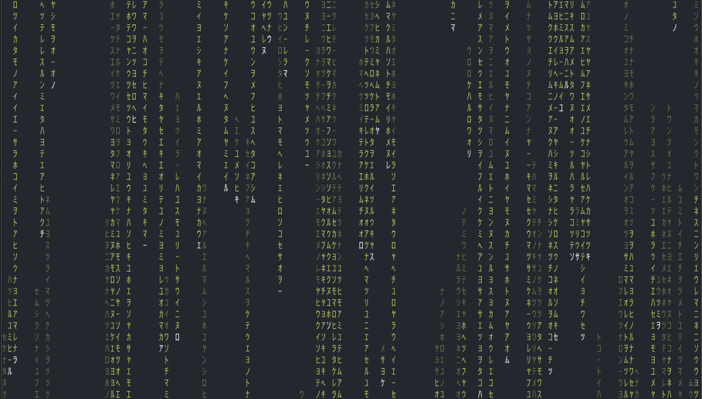

# ccmatrix
This project is to build your own falling text generator that simulates the falling green text from The Matrix.

## Image of what will be the end result
It'll look like this:

## What am I going to learn:
how to :
- how to draw anywhere on the screen.
- how colors are produced.
- how to read key presses without waiting for the Enter key.
- how to react when the window changes size.

## The challenge:
In this challenge you’re going to build a program that will take over the terminal, fill it with columns of random characters that fall at different speeds, and give the whole thing the glow of the film. It will also accept a handful of command line options, so you can change the speed, the colours and the characters it uses.

The core of this challenge is the same in any language, so pick whatever you are most interested in having fun with / learning.

## Link to the challenge
[Matrix Falling Text Generator](https://codingchallenges.substack.com/p/coding-challenge-144-matrix-falling?r=gjveo&utm_campaign=post&utm_medium=web)